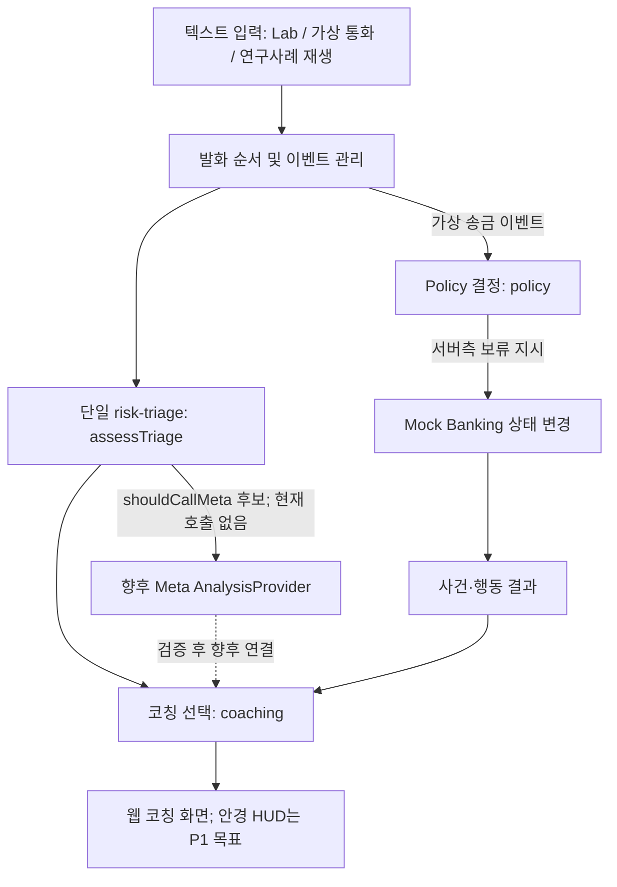

# 현재 구현 아키텍처 업데이트: v0.6.5 Gate 2

**최신 구현 기준: `README.md` + [`ADR-0011_CASE_TEMPORAL_STATE.md`](ADR-0011_CASE_TEMPORAL_STATE.md)**. 아래 v0.3~v0.6.4 세부 구조는 역사 기록으로 유지하며, 구 버전에서 "현재 구현"이라는 표현은 해당 당시 기준으로 읽어야 합니다.

`Meta 전사/기존 발화 → assessTriage() (단일 로컬 분석기) → RiskEvidenceCheckpoint → Case Coordinator(사건/리비전/멱등성) → Situation Risk / Live Signals(현재 긴박도·압박·피해 행동) → 기존 Coaching / Policy(유지)`

- Case Coordinator는 위험 탐지기·외부 행동 관리자·영속 DB가 아닌 **오프라인 내부 상태 변환 함수**입니다.
- `RiskEvidenceCheckpoint`는 기존 신호를 보관하며, 전사 정정 시 근거를 재계산합니다.
- Live Signals는 새 확률 모델이 아니라 기존 신호의 결정적 파생 점수입니다.
- 최신 실험 화면 `/lab/replay`, `/lab/voice`에서 화면용 상태를 계산합니다.
- 실제 Meta 의미 분석/교범/가족 확인·카드/경찰 외부 연동은 미구현입니다.

---

# SafeCall Guardian — 현재 기준 아키텍처 v0.3 (2026-10-27)

> **이 문서가 현재 코드와 책임 범위를 설명하는 유일한 기준 문서(Single Source of Truth)다.** ADR-0002~0004는 과거 설계 결정과 확장 제안 기록이다. 새 엔진을 계속 만든다는 뜻이 아니다.

## 한 문장으로 이해하기

**Next.js 웹앱 1개 + 1차 위험 분석기 1개 + 모듈별 서로 다른 책임.**

- `/lab`: 사용자가 텍스트를 직접 입력해서 **같은 분석기**를 시험하는 화면.
- `/simulator`: 가상 통화를 순차 재생하고 사용자 행동을 처리하는 화면. **같은 분석기**를 호출.
- 이후 텍스트·영상 사례 재생기: 새 감지 엔진을 만드는 것이 아니라 **같은 분석기의 입력 방식만 바꿈**.



**중요:** 현재 가상 송금은 위험 점수와 관계없이 **항상 보류**된다. 모델이 거래 승인 여부를 결정하지 않는다.

## 역할 구분 — 이름은 많아도 위험 감지기는 하나

| 모듈/파일 | 딱 한 가지 책임 | 현재 구현 상태 |
|---|---|---|
| `src/modules/risk-triage/index.ts` | **유일한 오프라인 텍스트·행동 위험 분석**. `assessTriage()`가 위험·심리압박·트리거를 산출 | ✅ 구현(실험용 규칙) |
| `src/modules/simulation/engine.ts` | 세션 발화 순서·상태 전이 **조정**; 판단은 `assessTriage`에 위임 | ✅ 통합 완료 |
| `src/modules/coaching/index.ts` | 분석/거래 상태에서 안전 안내 문장 **선택** | ✅ 데모 안내, 공식 근거 검토 미완료 |
| `src/modules/policy/index.ts` | 가상 송금 보류라는 서버 정책 **결정** | ✅ 데모 정책(무조건 보류) |
| `src/modules/mock-banking/index.ts` | 가상 계좌·거래 상태 보류/취소 **집행** | ✅ 단일 거래 데모, 실제 은행 아님 |
| `src/modules/simulation/store.ts` | 시뮬레이션 RAM 세션 관리 | ✅ 로컬 데모, 배포용 아님 |
| `src/modules/analysis/index.ts`, `src/lib/contracts.ts` | **미래 Meta API 공급자 규격** | 🟡 인터페이스뿐, 실제 호출 없음 |
| `src/modules/conversation/index.ts` | 미래 대화 이벤트 타입 계약 | 🟡 타입만 |
| `src/app/api/triage/route.ts` | `/lab`용 JSON 검증 후 **동일 `assessTriage()` 호출** | ✅ 구현 |
| `src/app/api/simulations/...` | 데모 상태 머신 API | ✅ 구현 |
| `src/components/simulator.tsx`, `src/app/lab/page.tsx` | UI 표시; 점수 자체를 계산하면 안 됨 | ✅ 구현 |

## 실행 순서

1. 사용자 `NEXT_LINE` → 시뮬레이터가 발화를 세션에 추가한다.
2. `assessTriage({turns})` 한 번 호출 → 신호 코드, 근거, 임시 지수, `shouldCallMeta` 산출.
3. `selectDemoCoaching(...)` → 이번 상태에 맞는 **데모 문구** 선택.
4. 가상 송금 버튼 → `assessTriage({turns, actionEvent:'TRANSFER_PREPARED'})` 재평가 → `decideDemoTransfer()` → `holdDemoTransfer()`.
5. 취소 버튼 → `cancelDemoTransfer()` → 코칭 갱신 → 타임라인 기록.
6. `/lab`과 데이터 재생 평가에서도 동일 `assessTriage()`를 사용한다. 정답 라벨은 실험 코드가 **별도로** 보관한다.

## 실험에서 중요한 구분

- **Caller identity**: 연락처 일치 ≠ 신원 인증. 현재 실물 발신자 식별 기능 미구현.
- **Triage trigger**: `shouldCallMeta=true`는 **실제 Meta API 호출이 아니라 후보 결정**이다.
- **Risk index**: 0–100 임시 점수일 뿐 사기 확률이 아니다.
- **Psychological pressure**: 관찰된 표현의 간이 지수. 가스라이팅·범죄 사실 확정이 아니다.
- **Model analysis**: Meta API 연동은 다음 마일스톤. 그때도 `AnalysisProvider`를 **risk-triage 다음에** 붙이며 추가 규칙 엔진을 만들지 않는다.
- **Coaching**: 현재는 예시 문구; 공식 지침과 출처가 검토된 지식 데이터로 바꿔야 함.
- **Mock banking**: 실제 돈은 절대로 이동하지 않는다. 현실 금융거래 차단 권한 없음.
- **Audio**: 녹음/전사 미구현; 오디오 청크는 전화 녹음 권한을 제공하지 않음.
- **Glasses**: 코칭 상태를 표시하는 UI 확장일 뿐 별도 판단 엔진이 아님.

## 향후 Meta 통합 위치(미구현)

`assessTriage()` → `shouldCallMeta`면 서버에서 **하나의 `AnalysisProvider`** 호출 → 구조화 응답 검증 → 코칭 입력에 분석 결과 반영. 음성은 허용된 `AudioSourceAdapter → STT`를 거쳐 동일 발화 입력으로 전환. 서버 정책과 거래 모듈은 모델과 독립적으로 유지한다.

## 향후 영상·텍스트 평가 위치(미구현)

`출처·이용권한 확인 → 개인정보 제거/합성 대화 → 순서별 턴 재생 → 동일 assessTriage → 사전에 숨겨 둔 정답 라벨과 비교`.

상세 데이터 설계: [REPLAY_DATA_FLOW.md](REPLAY_DATA_FLOW.md). 결정을 내린 이유: [ADR-0005](ADR-0005_SINGLE_RISK_ENGINE.md).

## API와 상태 저장소 한계

- `POST /api/triage`: 단일 오프라인 분석. 입력 길이 제한·Zod 검증.
- `POST /api/simulations` 및 `/api/simulations/{id}/events`: 데모 세션 생성/행동 적용.
- 세션은 서버 메모리에 임시 저장(30분 TTL). 인증·사용자별 접근 제어가 없으므로 **실제 통화·고객 데이터 사용 및 인터넷 공개 서비스에 사용하지 않는다**.
- 외부 서비스/하드웨어 접근 권한이나 API 토큰 없음. 향후 인증·Rate Limit·출처 데이터 라이선스·데이터 최소화가 필요.

## 검증과 사실 상태

- 리팩토링 시 `node --experimental-strip-types --test tests/simulation.test.ts tests/triage.test.ts tests/refactor-integration.test.ts`: **18개 통과**.
- `npm run check:static`: 정적 검사 통과.
- `npm install`, `npm run build`, Next.js 브라우저 렌더링, 실제 Meta 호출은 **이번 작업에서 수행하지 않음**.
- GitHub 업로드·커밋·수정 없음.

---

## v0.4 변경 — 새 위험 엔진 없이 공개 수법 기반 텍스트 평가

```text
src/data/scenarios/{sources,cases}.json (모두 자체 창작 대화)
            ↓ 1~N개 발화 prefix, 정답·미래 발화 제외
src/modules/evaluation/replayScenario()
            ↓
src/modules/risk-triage/assessTriage()   ← /lab 및 /simulator 동일 함수
            ↓
src/modules/coaching/selectDemoCoaching() ← 데모 코칭만
            ↓
src/app/lab/replay (선택, 재생, 위험 변화, 출처, 측정값)
            ↓
src/modules/evaluation/evaluateDataset()  → reports/replay-results.json
```

`keywordBaseline()`은 벤치마크 계산 내부에만 쓰는 비교기로 제품용 정책 엔진이 아니다. **분석 엔진의 수는 늘어나지 않는다.** Meta API는 연결하지 않았고 트리거 표시는 후보만 의미한다. 새 파일/데이터 타입은 `docs/RESEARCH_DATASET.md`, `docs/EVALUATION_PROTOCOL.md`를 따른다. 기존 API·모의 은행 로직을 변경하지 않았다.


## v0.5 Meta 분석 공급자 (2026-10-27)
RiskTriage `assessTriage()`는 기존 그대로 유지한다. `src/modules/analysis/`은 Meta 분석 **공급자**만 포함하며 새 탐지 엔진이 아니다. `/lab/replay`의 순차 텍스트는 `buildReplayMetaInput`을 통해 정답·미래발화 없이 전달되며, 서버의 제한된 API 경로가 **OFFLINE / MOCK / 명시적 LIVE**를 구분한다. 위험 정책·은행 통제는 절대 Meta에 위임하지 않는다. 자세한 내용은 `docs/META_INTEGRATION.md`.

## v0.6 audio pipeline addendum (2026-10-28)

Existing `assessTriage()` remains the single offline risk scorer. Local audio gateway, ASR event accumulator, budget guard, and `/lab/voice` were added as **supporting** modules, not alternative fraud engines. See [ADR-0006](ADR-0006_REALTIME_VOICE_PIPELINE.md), [protocol](VOICE_STREAMING_PROTOCOL.md), and [budget](META_API_BUDGET_CONTROL.md). LIVE unverified; full Next.js build unverified.


## v0.6.2 예외처리 계층 (ADR-0008)
`AudioSourceAdapter` → Meta STT → `assessTriage()`(유일한 로컬 위험 엔진) → 기존 MetaAnalysisProvider → Policy/Coaching.
LIVE 이전에 `LiveAuth`(localhost 접근 코드/VOICE 티켓), `CostGuard`(예약·measured·liability), 서버 동의 확인을 거친다. ASR UNKNOWN 화자는 임의로 caller 취급하지 않는다. 공식 이벤트에서 늦게 도착한 완료 발화를 보존하고, 분석 텍스트를 조용히 잘라내지 않는다. 관련 문서: [ADR-0008](ADR-0008_V062_RELIABILITY_HARDENING.md).


## v0.6.3 Local Integration Gate (2026-10-28)

**통합 데이터 흐름은 변경되지 않음:** 허용된 대본/음성 → 오디오/전사 계층 → 기존 `assessTriage()` → 기존 MetaAnalysisProvider (기본 비활성) → 기존 Policy/Coaching/Mock Banking. 새로운 위험 엔진 없음.

로컬 통합 테스트는 실제 게이트웨이 메시지 핸들러에 Fake WebSocket을 주입해 인증·동의 철회·사용량 정산을 오프라인으로 검증함. 실제 브라우저 및 운영 Meta 연결은 아직 미검증. 상세: `docs/ADR-0009_LOCAL_INTEGRATION_GATE.md`.

## v0.6.4 Gate 0/1 (2026-10-28)

현재 구현: 단일 `assessTriage()`는 전체 제공 발화를 스캔, 선택적 `priorSignals`(서버 신뢰 입력)와 최소한의 `conversation/risk-checkpoint.ts`에서 과거 사실을 보존·정정할 수 있음. `MetaAnalysisProvider`는 `max_completion_tokens`를 전달하고 `finish_reason=stop`만 성공 처리. `/api/meta/session`은 별도 개발자 로컬 승인 + 서명된 Spark 세션을 발급하며 `/api/meta/analyze`는 같은 티켓을 반복 사용해 비용 세션을 통합. API LIVE 자체는 비활성이고 UI에서 인증 경로도 미구현.

아직 설계만: Case Coordinator 영속 스냅샷·Live Signals·공식 행동 교범·가족 확인·카드 잠금. 이전 v0.6.3 실행 문서는 역사적 기록이다. 빌드는 npm 미설치로 검증 불가. `ADR-0010`과 `V064_BUILD_REPORT`를 기준으로 읽는다.


## v0.6.6 OFFLINE playbook/Live Guidance boundary (2026-10-29)

`finalized utterance -> assessTriage() checkpoint (one scorer) + observational family-claim tags -> in-memory CaseState -> selectLiveGuidance() -> static reviewed card priority -> action / optional fixed reply / public source IDs -> UI`.

`selectLiveGuidance` is an offline pure function. Meta scores and suggestions are NOT additional risk engines and cannot alter fixed card priority. `modelStateVersion` must match the current case revision and all model evidence IDs must correspond to active caller-attributed finalized turns, otherwise they are discarded. `safeToSpeak` is a fictional user-selected display option, not a safety determination. Threat/abduction guidance always returns `NO_SCRIPT`. The UI displays the action but never executes a call or banking operation. Cases are memory-only; persistence, external family verification and browser E2E are not implemented/verified. Full build deferred by user. See ADR-0012 and v0.6.6 reports.
